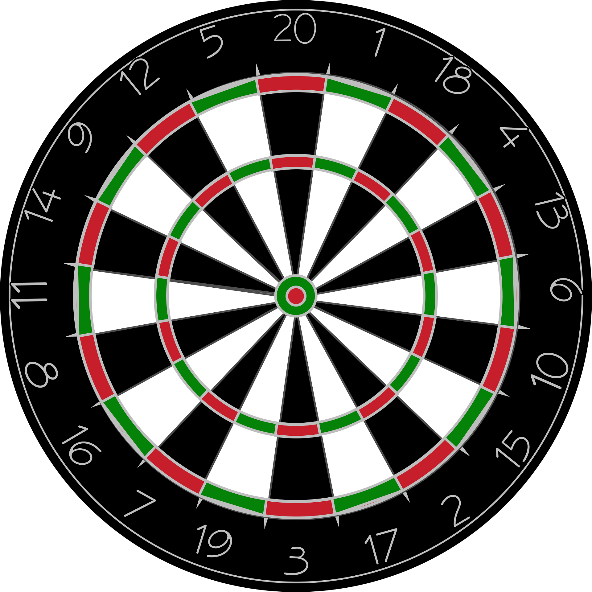
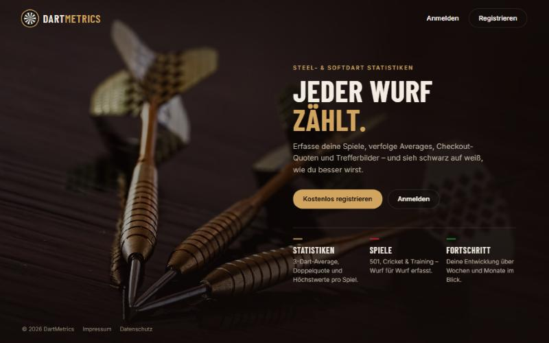
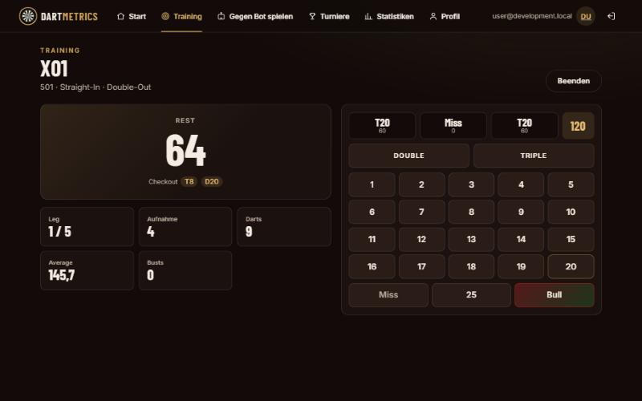
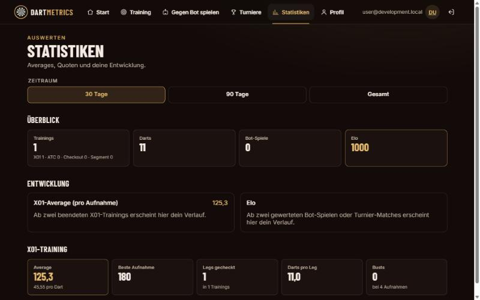

<div align="center">



# DartMetrics

**Every dart counts.** Self-hosted darts scoring, training and statistics – with AI opponents that learn from every game.

[](https://github.com/ManuelPeise/DartMetrics/actions/workflows/build.yml)
[](LICENSE)


</div>

DartMetrics records steel and soft-tip darts **dart by dart**, turns them into statistics and lets you play against **DartBots**: virtual opponents with realistic throw simulation that level up and improve their target selection with **ML.NET**. Runs on your own PC or a Raspberry Pi with one Docker command – no cloud, no tracking.

> The user interface is currently in **German**. Code, API and this README are in English; the detailed docs are in German.

<p align="center">
  
  
  
</p>

## Features

**Play & train**
- **X01** (301/501) with straight/double-in and double/straight-out, sets of legs
- **Checkout**, **segment** and **around the clock** training
- **Checkout hints** after every dart (fewest darts, preferred doubles: T20 · T20 · Bull)
- Fast dart-by-dart input pad, works on phone, tablet and desktop; unfinished games resume after a reload

**DartBots**
- Opponents from level 0 (beginner) to 20 (pro) with Elo rating and experience points
- Realistic throws: scatter around the target, form swings, pressure on the checkout
- Target selection that follows standard checkout routes and is computed exactly for each bot's own throwing profile (no machine learning needed)
- Bots learn from games against humans and level up

**Tournaments**
- **Leagues** (round robin with table) and **knock-out** brackets (byes, seeding from a league)
- Official tournaments run by a game master, private tournaments for every player
- Bot-vs-bot matches play themselves at their scheduled time – watch them live

**Statistics**
- Averages, checkout and hit rates per training mode, wins against bots
- Average and Elo history for 30 days, 90 days or all time

**Admin & privacy**
- Admin area: users and roles, bots, ML models, system logs, dashboard
- Privacy by design: no third-party requests (fonts self-hosted), only a technically necessary login cookie, automatic deletion of unverified accounts and old logs, self-service account deletion
- Imprint and privacy policy templates (German law) filled from your configuration

## Quickstart

Requirements: [Docker](https://docs.docker.com/get-docker/) and, on Windows, PowerShell.

```bash
git clone https://github.com/ManuelPeise/DartMetrics.git
cd DartMetrics/sources
cp .env.example .env          # set passwords, JWT_KEY, CERT_PASSWORD, LEGAL_* (imprint)
./deploy/deploy.ps1           # Windows
./deploy/deploy.sh            # Linux / Raspberry Pi
```

The deploy script checks your configuration, creates an HTTPS certificate and the fonts if missing, builds and starts all containers.

Then open **https://localhost:7254** and sign in with `ADMIN_EMAIL` / `ADMIN_PASSWORD` from your `.env` (you will be asked to change the password).

Prefer plain Docker Compose? `docker compose up -d` in `sources/` works too – see the [technical documentation](sources/README.md#schnellstart).

## Documentation

| | |
|---|---|
| [User guide](docs/user-guide.md) | Accounts, dart input, training, bots, tournaments, statistics, administration *(German)* |
| [Technical documentation](sources/README.md) | Setup, deployment scripts, production on a Raspberry Pi, running your own instance *(German)* |
| [Architecture](sources/ARCHITECTURE.md) | Projects, dependencies, runtime, services, API *(German)* |
| [Bot trainer](sources/Tools.BotTrainer/README.md) | Developer tool: bot benchmark and calibration *(German)* |
| [Contributing](CONTRIBUTING.md) | How to report bugs, propose features and open pull requests |
| [Security](SECURITY.md) | How to report vulnerabilities privately |

## Tech stack

.NET 10 · ASP.NET Core Web API · Blazor (WebAssembly + Interactive Server) with a backend-for-frontend · Entity Framework Core · MySQL 8.4 · Docker Compose · xUnit + Testcontainers · GitHub Actions

## Roadmap

- [x] Training modes, bot games, tournaments, statistics, admin area
- [x] ~~ML.NET target selection~~ replaced by exact checkout planning (bot V2 in progress)
- [x] Security & privacy hardening (rate limiting, data retention, self-hosted assets)
- [ ] **V1 beta** – testing on self-hosted instances *(current)*
- [ ] UI polish from beta feedback, end-to-end UI tests
- [ ] Raspberry Pi production guide (reverse proxy / tunnel, HTTPS)
- [ ] Admin statistics and settings pages
- [ ] Account lockout after repeated failed logins
- [ ] English user interface
- [ ] More game modes (e.g. Cricket)

Ideas and feedback are welcome – open an [issue](https://github.com/ManuelPeise/DartMetrics/issues).

## Contributing

Bug reports, feature ideas and pull requests are welcome. Please read [CONTRIBUTING.md](CONTRIBUTING.md) first. Security issues: please report privately, see [SECURITY.md](SECURITY.md).

## License

- **Code:** [MIT](LICENSE) © 2026 Manuel Peise
- **Images** (Pixabay Content License) and **fonts** (SIL Open Font License 1.1) are not covered by the MIT license – see [THIRD-PARTY-NOTICES.md](THIRD-PARTY-NOTICES.md).

If you host DartMetrics yourself, **you** are the operator: imprint, privacy policy, updates and backups are your responsibility (see [running your own instance](sources/README.md#eigene-instanz-betreiben)).
